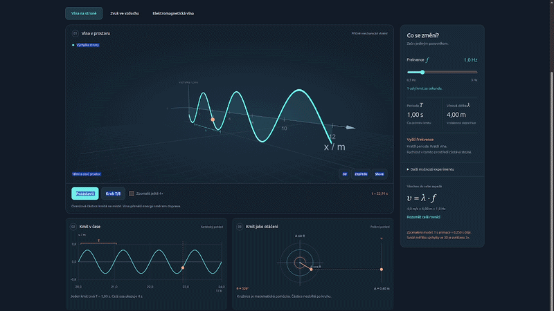

# Frekvence — laboratoř vlnění

[English](README.md)

> 🚀 **Spustit online v prohlížeči:** [https://school.vibemaker.cz/frekvence/](https://school.vibemaker.cz/frekvence/)  
> *(Běží přímo v prohlížeči · PWA offline · Bez instalace a registrace)*

Responzivní SPA pro středoškolskou fyziku. Vstupní soubor je `index.html`.

## Co nabízí

- Otáčitelnou 3D scénu, kartézský časový graf a polární fázor téhož místa.
- Strunu, zvuk ve vzduchu a lineárně polarizovanou elektromagnetickou vlnu ve vakuu.
- Frekvenci, amplitudu, počáteční fázi, místo sledování, pauzu, krok T/8 a zpomalení.
- Porovnání s nulovou počáteční fází, prostorové měřítko, export PNG a kopírování rovnice.
- Instalaci z menu, návod pro iOS a offline běh bez externích CDN.

## Spuštění

Aplikace nepotřebuje sestavení ani instalaci balíčků:

1. **Online:** Otevři [https://school.vibemaker.cz/frekvence/](https://school.vibemaker.cz/frekvence/)
2. **Offline / Lokálně:** Otevři `index.html` přímo v libovolném moderním prohlížeči (dvojklik stačí).

Přidání na plochu a automatická offline cache fungují při spuštění přes zabezpečené HTTPS.

## Fyzikální model a měřítka

`u(x,t) = A sin(2π(ft − x/λ) + φ₀)`, `λ = v/f`, `T = 1/f`.
Rychlost je při změně frekvence konstantní. Pouze u struny lze nastavit jiné modelové prostředí.
Při lineární polarizaci je E podél y a B podél z. Při kruhové polarizaci E=(0,A sin θ,A cos θ), B=(0,−A cos θ/c,A sin θ/c). V obou případech E × B ukazuje do +x.
Pole E a B jsou ve fázi; jejich grafická měřítka jsou nezávislá. Fázor není dráha částice.
U struny je 3D výchylka zvětšena 3×, u zvuku 300× (zadávaná amplituda v mm).
Časové a polární grafy zobrazují hodnoty v uvedených jednotkách bez tohoto prostorového zvětšení.
Při změně frekvence nebo rychlosti začíná simulační čas znovu. Graf ukazuje analytický průběh při aktuálních parametrech, nikoli zaznamenanou historii změn.

Zvuk: ideální vzduch s rychlostí 340 m/s. EM: vakuum s c = 299 792 458 m/s; použité frekvence jsou rádiové, nikoli viditelné světlo.
Model neobsahuje útlum, disperzi, odrazy ani nelinearity. Animace je zpomalena, její časové měřítko je uvedeno u ovládání.

## PWA a aktualizace

Všechny závislosti jsou lokální. Service worker ukládá pouze prostředky této aplikace.
Při každém vydání změnit verzi CACHE v `sw.js`. Nová verze se aktivuje po uzavření starých karet aplikace.
Cizí cache na stejném webu zůstávají nedotčené.
Ovládání instalace vychází z [MDN: Trigger installation](https://developer.mozilla.org/en-US/docs/Web/Progressive_web_apps/How_to/Trigger_install_prompt).

## Ověření

Testováno v izolovaném Chrome: všechny režimy, vztahy T a λ, pauza/krok, šířky 360/390/768/1440 px, registrace service workeru a opětovné načtení offline.
Skutečná instalace na fyzickém iPhonu a Androidu vyžaduje ověření na těchto zařízeních.

Three.js r128 a OrbitControls jsou distribuovány pod licencí MIT, viz `vendor/LICENSE.txt`.

Autor: Luděk Sušický — biolog, středoškolský a vysokoškolský učitel informatických předmětů

## Šroubovice a kulové vlnoplochy (2.1)

V elektromagnetickém režimu jsou tři podrežimy. Šroubovice spojuje konce E v různých polohách ve stejném čase; zobrazuje kruhovou polarizaci, nikoli fotonovou trajektorii. Kružnice pod scénou nyní zobrazuje skutečné složky E_z a E_y, časový graf pouze E_y.

Kulové slupky označují maxima fáze θ(r,t)=2π(ft−r/λ)+φ₀. Jejich rozestup je λ a postupují rychlostí c. Jde o schéma vlnoploch v homogenním prostředí daleko od lokalizovaného zdroje, ne úplné pole izotropní elektromagnetické antény. Blízké pole ani vyzařovací diagram nejsou modelovány. Průhlednost není intenzita; graf je bezrozměrný sin θ a amplituda je v tomto podrežimu vypnuta.

Výpočtově ověřeno: E·B=0, E×B směřuje do +x, stálá velikost kruhově polarizovaného E, periodicita, fáze slupek a rychlost jejich šíření. Prohlížeč: přepínání režimů, návrat ke struně, vysvětlení, 390px zobrazení a offline načtení včetně physics.js.

Zdroje: [Richard Fitzpatrick: Polarization of Electromagnetic Waves](https://farside.ph.utexas.edu/teaching/jk1/Electromagnetism/node72.html), [Steven Ellingson: Types of Waves](https://phys.libretexts.org/Bookshelves/Electricity_and_Magnetism/Electromagnetics_I_%28Ellingson%29/09%3A_Plane_Waves_in_Loseless_Media/9.03%3A_Types_of_Waves).

## Česká a anglická verze (3.0)

[English documentation](README.md)

Aplikace má v hlavičce přepínač EN / CS. Volba se ukládá místně a platí i při offline načtení. Přepnutí zachová experiment a pohled kamery; otevřená nápověda se zavře. Při první návštěvě se podle hlavního jazyka prohlížeče zvolí čeština pro české nastavení, jinak angličtina. Uložená ruční volba má přednost. Poloha uživatele se nezjišťuje. Název nainstalované aplikace je dvojjazyčný.

Překlady jsou v `translations.js`, obsluha v `i18n.js`. České texty slouží jako klíče; překlad zachovává proměnné a vzorce. Při změnách runtime souborů je nutné zvýšit verzi cache v `sw.js`. Nové závislosti patří do jeho seznamu `ASSETS`.

Aplikace nemá účty, backend ani analytiku. Místně ukládá jazyk a offline soubory. Rovnici kopíruje do schránky pouze na vyžádání, export PNG vytváří v prohlížeči. Vědecké zdroje se otevírají až po kliknutí na odkaz.

Podrobnosti k aktuálnímu ověření: [docs/VERIFICATION.md](docs/VERIFICATION.md).

## Licence a autor

Vlastní kód aplikace a dokumentace: [MIT](LICENSE). Three.js a OrbitControls si zachovávají původní oznámení v [vendor/LICENSE.txt](vendor/LICENSE.txt).

### Autor

**Luděk Sušický** — biolog, středoškolský a vysokoškolský učitel informatických předmětů

- E-mail: [ludek.susicky@gmail.com](mailto:ludek.susicky@gmail.com)
- X: [@ludeksusicky](https://x.com/ludeksusicky)
- LinkedIn: [Luděk Sušický](https://www.linkedin.com/in/ludek-susicky/)
- GitHub: [@siberius](https://github.com/siberius) — další vzdělávací projekty a otevřené aplikace

Aplikace je příkladem SPA (Single Page Application) v jediném HTML souboru.

Repozitář: [siberius/frekvence](https://github.com/siberius/frekvence)

## Mobilní Safari a plocha telefonu

Rozložení se přizpůsobuje telefonu i tabletu na výšku a na šířku, bezpečným okrajům displeje i proměnlivé výšce lišt Safari. Instalaci najdeš v **Menu → Instalovat na plochu**. Na iPhonu a iPadu pokračuj v Safari přes Sdílet → Přidat na plochu a ponech zapnuté Otevřít jako webovou aplikaci, pokud se tato volba nabízí. Podporované prohlížeče Androidu otevřou dostupnou systémovou výzvu, jinak aplikace zobrazí ruční postup. Při spuštění z plochy se nabídka instalace skryje.

Podrobnosti uvádí [návod Applu](https://support.apple.com/guide/iphone/iphea86e5236/ios). Offline použití vyžaduje první úspěšné načtení přes HTTPS a stav Připraveno bez internetu. Instalaci na fyzickém telefonu je nutné ověřit ručně.

Ikony mají vektorové zdroje SVG v `icons/`, samostatnou variantu pro ořez Androidu a neprůhlednou 180px ikonu pro iPhone.
