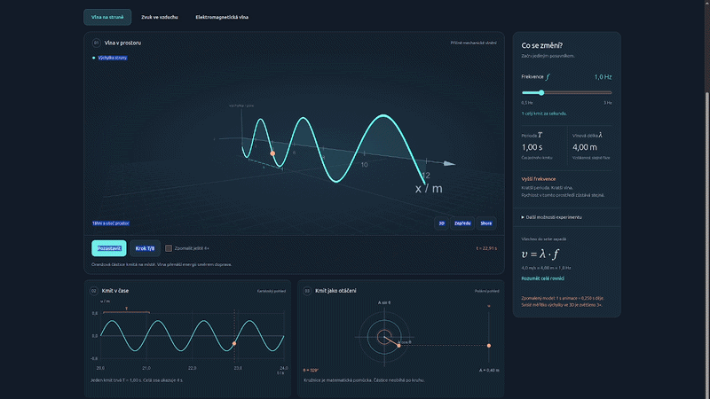

# Frequency: wave laboratory

[Česky](README.cs.md)

> 🚀 **Online version / Live web app:** [https://school.vibemaker.cz/frekvence/](https://school.vibemaker.cz/frekvence/)  
> *(Run directly in your browser · Offline-ready PWA · No registration)*

An interactive laboratory for secondary-school physics. Explore one wave through a 3D scene, a time graph and a polar phase view. Change frequency while keeping the medium's speed fixed, pause the simulation and advance it by one eighth of a period.

## Run

No build, package installation or backend is required. All runtime dependencies are included locally:

1. **Online:** Open [https://school.vibemaker.cz/frekvence/](https://school.vibemaker.cz/frekvence/)
2. **Offline / Local:** Open `index.html` directly in any modern browser (double-click is enough).

PWA installation and offline service-worker caching activate when served over HTTPS.

## Experiments

- Transverse waves on a string
- Longitudinal sound waves in air
- Electromagnetic waves in a vacuum: linear or circular polarization, plus a schematic spherical-wavefront view

Controls include frequency, amplitude, initial phase, observation position, a zero-phase reference, camera views and a PNG export. String wave speed is adjustable; the air and vacuum models keep it fixed.

## What the model means

The traveling wave uses `u(x,t) = A sin(2π(ft − x/λ) + φ₀)`, with `λ = v/f` and `T = 1/f`. Changing frequency resets simulation time. The graph shows the analytical wave for the current parameters, not a recorded history.

Animation is slowed down by the factor displayed in the interface. String displacement is magnified 3× in 3D; sound-particle displacement is magnified 300× relative to its value in meters. Graph values retain the stated units. Electric and magnetic fields use independent visual scales.

The model excludes damping, dispersion, reflections and nonlinear effects. Air has a fixed sound speed of 340 m/s. Electromagnetic waves use the vacuum speed 299,792,458 m/s and radio frequencies, not visible light.

The circular-polarization helix connects field-vector tips at different positions at one instant. It is not a photon trajectory. Spherical shells mark equal phase, not matter or light particles. They do not represent the complete field or radiation pattern of an antenna; brightness is not intensity.

## Offline use and privacy

After the menu reports “Ready offline”, the service worker has cached the application for later offline visits. The browser may evict that cache. A cached update becomes active after older app tabs close. Only caches with this application's prefix are removed.

The app uses no accounts or backend and includes no analytics. Language preference is stored locally. Equation copying uses the clipboard only when requested; image export creates a local PNG. External scientific references open only when selected.

## Project structure

| File | Purpose |
|---|---|
| `index.html`, `style.css` | Interface and responsive layout |
| `app.js` | Simulation controls, graphs and 3D rendering |
| `physics.js` | Pure field geometry and wavefront calculations |
| `i18n.js`, `translations.js` | Local Czech/English translation |
| `sw.js`, `manifest.webmanifest` | Offline cache and installation metadata |
| `vendor/` | Three.js r128, OrbitControls and their license |

When changing runtime files, update the cache version in `sw.js` and include new dependencies in `ASSETS`. Translation keys are the Czech source copy; English translations preserve interpolation and formulas. See [verification](docs/VERIFICATION.md).

## License and author

Three.js and OrbitControls retain their MIT notice in [vendor/LICENSE.txt](vendor/LICENSE.txt). The original application code and documentation are licensed under [MIT](LICENSE).

### Author

**Luděk Sušický** — biologist, secondary-school and university teacher of computing subjects

- E-mail: [ludek.susicky@gmail.com](mailto:ludek.susicky@gmail.com)
- X: [@ludeksusicky](https://x.com/ludeksusicky)
- LinkedIn: [Luděk Sušický](https://www.linkedin.com/in/ludek-susicky/)
- GitHub: [@siberius](https://github.com/siberius) — more educational projects and open-source applications

The app is an example of an SPA (Single Page Application) in a single HTML file.

## Scientific references

- [Richard Fitzpatrick: Polarization of Electromagnetic Waves](https://farside.ph.utexas.edu/teaching/jk1/Electromagnetism/node72.html)
- [Steven Ellingson: Types of Waves](https://phys.libretexts.org/Bookshelves/Electricity_and_Magnetism/Electromagnetics_I_%28Ellingson%29/09%3A_Plane_Waves_in_Loseless_Media/9.03%3A_Types_of_Waves)

Repository: [siberius/frekvence](https://github.com/siberius/frekvence)

## Mobile Safari and home screen

The layout adapts to phones and tablets in portrait and landscape, including safe areas and Safari's changing browser-bar height. Open **Menu → Install on home screen** for installation. On iPhone/iPad, follow Safari's Share → Add to Home Screen flow and leave Open as Web App enabled when offered. Supported Android browsers use their native install prompt when available; otherwise the menu provides manual steps. The install entry is hidden when launched from the home screen.

See [Apple's installation instructions](https://support.apple.com/guide/iphone/iphea86e5236/ios). Offline use requires a first successful load over HTTPS and the Ready offline status. Physical-device installation remains a manual release check.

App icons are maintained as SVG sources in `icons/`; PNG exports include a dedicated Android maskable icon and a 180 px Apple touch icon.
